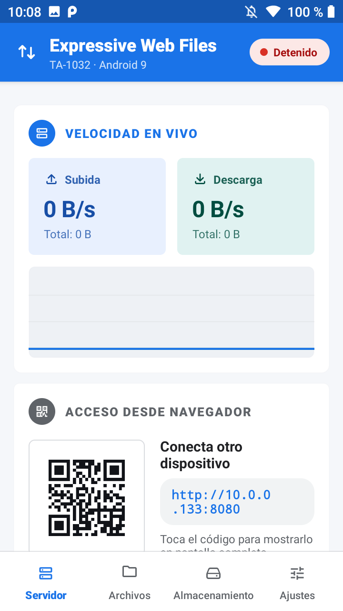
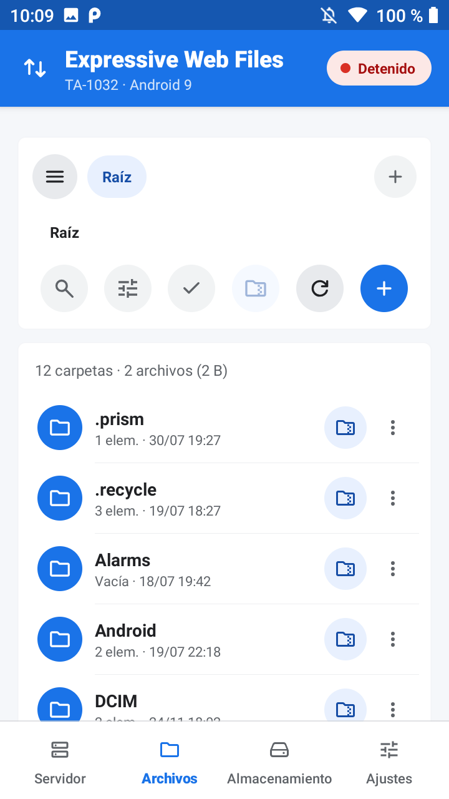
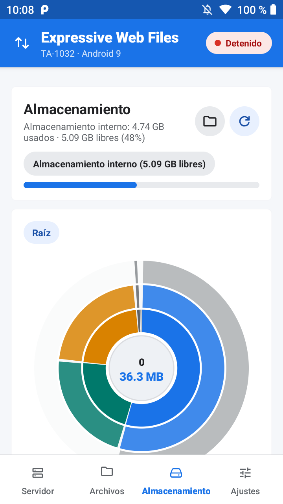
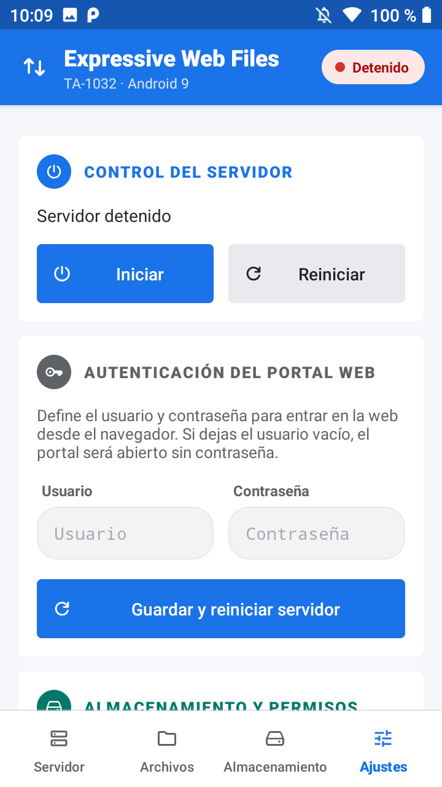

# Expressive Web Files

-3DDC84?logo=android&logoColor=white)
-ED8B00?logo=openjdk&logoColor=white)
-4285F4)


**Expressive Web Files** es una aplicación Android ligera y sin dependencias externas que combina en una sola herramienta:

1. **Portal Web LAN de alta velocidad con URL amigable (`<marca>.files.local`)** para enviar y recibir archivos y carpetas completas desde cualquier navegador en la misma red Wi-Fi sin necesidad de memorizar la IP.
2. **Explorador de archivos avanzado estilo MiXplorer** con pestañas múltiples, bibliotecas por categoría, descarga múltiple directa sin ZIP, compresión `.zip` / `.tar.gz`, editor de texto, visor de imágenes y soporte para almacenamiento externo (**microSD y USB OTG / Tipo-C**).
3. **Analizador visual de almacenamiento estilo DaisyDisk / SquirrelDisk** con gráfico interactivo **Sunburst**, marcado por pulsación prolongada y revisión de elementos marcados antes de liberar espacio.
4. **Diseño camaleónico nativo y personalización Monet** que detecta la versión de Android o la capa del fabricante (One UI, HyperOS, Nothing OS, ColorOS, realme UI, MagicOS, EMUI, Material Design/Theme/You/Expressive) y adapta tanto la app nativa como el portal web en tiempo real.
5. **Multi-idioma automático y actualizaciones integradas** en 6 idiomas desde el sistema operativo y comprobación directa contra GitHub Releases.

---

## Características principales

### 1. Portal Web LAN y Servidor HTTP de alto rendimiento (`Servidor`)
- **Acceso sencillo sin recordar la IP (`LocalDnsResponder`)**: servidor mDNS integrado (RFC 6762) que publica automáticamente **`http://<marca>.files.local:8080`** (por ejemplo `pixel.files.local`, `nokia.files.local`, `samsung.files.local`, etc.), con **detección automática de colisiones** si hay otro dispositivo igual en la red (`<marca>2.files.local`, `<marca>3.files.local`, etc.).
- **Puerto inteligente e IP alternativa**: intenta abrir el puerto `80` (para omitir el puerto en la URL cuando el sistema lo permita) con respaldo automático a `8080`, mostrando además la **IP alternativa** con copia en un toque y código **QR ampliable** a pantalla completa.
- **Motor HTTP/1.1 propio en Java puro** (`TransferServer`): conexiones persistentes *keep-alive*, *pool* de 24 hilos, buffers de 256–512 KB y escritura directa mediante `FileChannel`.
- **Subida paralela por bloques y carpetas completas**: transferencias fragmentadas de 4 MB (1, 2, 4 o 6 hilos simultáneos configurables desde la web) y subida de carpetas conservando toda su jerarquía (`webkitdirectory` y *drag & drop*).
- **Descarga directa y ZIP al vuelo**: soporte de cabeceras `HEAD` / `HTTP Range`, streaming `.zip` de carpetas y gráfica de velocidad en vivo (`SpeedGraphView`), cancelación instantánea y autenticación opcional mediante cookies `HttpOnly` (`SameSite=Lax`).

### 2. Explorador de archivos avanzado estilo MiXplorer (`Archivos`)
- **Pestañas múltiples** en App y Portal Web (hasta 6 pestañas simultáneas) para mover o comparar rutas rápidamente.
- **Descarga directa de varios archivos sin ZIP desde la web**: al seleccionar múltiples archivos en el portal web, el botón **Descargar** baja cada archivo individualmente (con un aviso explicativo mostrado una sola vez por sesión y persistido en cookies para autorizar descargas múltiples en el navegador).
- **Marcadores y bibliotecas inteligentes**: acceso directo a *Imágenes*, *Vídeos*, *Audio*, *Documentos*, *Archivos comprimidos* y *Recientes (7 días)*.
- **Soporte para medios externos (SD y USB OTG / USB-C)**: detección de volúmenes montados (`StorageVolumes`) mediante rutas virtuales `@ext/<volId>` con lectura, navegación y copia entre almacenamiento interno y externo.
- **Operaciones completas de portapapeles**: copiar, cortar, pegar, mover, renombrar, crear carpetas y archivos vacíos, borrado individual o por lotes y búsqueda recursiva.
- **Motor de archivos comprimidos (`.zip` y `.tar.gz` / `.tgz`)**: creación de paquetes, listado de contenido sin descomprimir y extracción segura con protección frente a *Zip-Slip* (`FolderZipper`).
- **Visor y editor integrados**: visor de imágenes en la web, editor de texto/código en vivo y diálogo de propiedades detalladas con cálculo de hashes **MD5 y SHA-256**.

### 3. Analizador visual de almacenamiento estilo DaisyDisk / SquirrelDisk (`Almacenamiento`)
- **Gráfico Sunburst interactivo multicapa**: renderizado nativo en `Canvas` (`SunburstChartView`) y en SVG interactivo en el portal web (`WebUiStorage`).
- **Exploración *drill-down***: toca un sector para entrar en la subcarpeta y toca el núcleo central para subir de nivel.
- **Marcado por pulsación prolongada y lista revisable**: igual que en **Archivos**, mantén pulsado cualquier archivo o carpeta para marcarlo para eliminar, y usa **«Ver lista»** para consultar todos los elementos marcados, retirar los que prefieras conservar o eliminarlos todos de golpe con seguimiento en vivo.

### 4. Diseño camaleónico nativo y personalización Material You (Monet) (`OsDesignSystem` + `OsSkinRenderer` + `ThemeTokens`)
- Detección automática de plataforma mediante `Build` y propiedades del sistema, con soporte completo de **Modo Claro / Modo Oscuro**, contraste verificado **WCAG AA** y sincronización de variables CSS hacia el portal web.
- **11 lenguajes de diseño nativos incluidos**:
  - **Capas de fabricante**: Samsung **One UI**, Xiaomi **HyperOS**, **Nothing OS**, OPPO **ColorOS**, **realme UI**, Honor **MagicOS** y Huawei **EMUI / HarmonyOS**.
  - **Android puro por versión**: **Material Design** (Android 8–9), **Material Theme** (Android 10–11), **Material You** (Android 12–15) y **Material 3 Expressive** (Android 16+).
- **Selector de color Material You (Monet)**: visible en **Ajustes** cuando hay un tema Material You activo, permitiendo elegir el **color automático del sistema** o cualquiera de las **8 paletas Monet personalizadas** (*Lavanda Pixel*, *Azul Océano*, *Verde Esmeralda*, *Ámbar Solar*, *Coral Terracota*, *Turquesa Glaciar*, *Índigo Noche* y *Rosa Sakura*).

### 5. Multi-idioma automático (6 idiomas) (`I18n` + `WebUiI18n`)
- Detecta directamente el idioma configurado en el sistema operativo (en la app) y en el navegador (en el portal web), con soporte completo en **Español**, **Inglés**, **Alemán**, **Francés**, **Japonés** y **Chino**.

### 6. Actualizaciones automáticas dentro de la app (`AppUpdater` + `UpdateInstallReceiver`)
- Conectado a **GitHub Releases**: comprobación automática en segundo plano (cada 24 h, activable/desactivable) y botón manual **Buscar actualizaciones** en **Ajustes → Acerca de**.
- Muestra las notas del *Release*, descarga el APK con barra de progreso, verifica la integridad **SHA-256** cuando se adjunta y lanza la instalación nativa mediante `PackageInstaller`.

### 7. Live Updates (Android 16+) y doble canal de notificaciones en vivo
- **Canal principal de servidor y transferencias (`fotospixel_live_updates`)**: compatible con *Promoted Ongoing Live Updates* de Android 16+ (`Notification.ProgressStyle`) y notificaciones persistentes con control de **Detener servidor** desde Android 8/9 en adelante (`TransferActionReceiver`).
- **Segundo canal para operaciones de archivos (`fotospixel_file_ops`)**: gestionado por `FileOpMonitor` para mostrar barra de progreso cuando se copian, mueven o eliminan carpetas grandes, indicando en tiempo real qué archivo se está procesando o borrando.

---

## Arquitectura sin dependencias (Zero-Dependency & Zero-Gradle)

El proyecto está escrito íntegramente en **Java 11 + Android SDK** estándar, sin librerías de terceros ni *wrapper* de Gradle. Se compila directamente con las herramientas oficiales del Android SDK (`aapt2`, `javac`, `d8`, `zipalign` y `apksigner`).

### Estructura del proyecto

```text
expressivewebfiles/
├── VERSION
├── build.sh
├── version.sh
├── release.sh
└── app/
    └── src/
        └── main/
            ├── AndroidManifest.xml
            ├── res/
            │   ├── drawable/
            │   └── values/
            └── java/com/fotospixel/transfer/
                ├── MainActivity.java
                ├── TransferService.java
                ├── TransferActionReceiver.java
                ├── TransferServer.java
                ├── TransferStats.java
                ├── LocalDnsResponder.java
                ├── WebUi.java
                ├── WebUiExplorer.java
                ├── WebUiStorage.java
                ├── WebUiI18n.java
                ├── FileOps.java
                ├── FileOpMonitor.java
                ├── FolderZipper.java
                ├── StorageVolumes.java
                ├── StorageAnalyzer.java
                ├── SunburstChartView.java
                ├── SpeedGraphView.java
                ├── QrCodeGenerator.java
                ├── OsDesignSystem.java
                ├── OsSkinRenderer.java
                ├── ThemeTokens.java
                ├── I18n.java
                ├── AppUpdater.java
                └── UpdateInstallReceiver.java
```

### Módulos principales

| Archivo | Responsabilidad |
| :--- | :--- |
| [`MainActivity.java`](app/src/main/java/com/fotospixel/transfer/MainActivity.java) | Interfaz nativa con 4 secciones (`Servidor`, `Archivos`, `Almacenamiento`, `Ajustes`), permisos, selector Monet/capas y listas interactivas. |
| [`TransferServer.java`](app/src/main/java/com/fotospixel/transfer/TransferServer.java) | Servidor HTTP/1.1 embebido (puerto `80` con respaldo a `8080`), sesiones, subidas por bloques, descargas con rango y API REST `/api/*`. |
| [`LocalDnsResponder.java`](app/src/main/java/com/fotospixel/transfer/LocalDnsResponder.java) | Respondedor mDNS (`<marca>.files.local`) + *beacon* `NsdManager` con detección automática de colisiones (`<marca>2.files.local`). |
| [`TransferService.java`](app/src/main/java/com/fotospixel/transfer/TransferService.java) | Servicio en primer plano (`dataSync`), Live Updates y gestión de los canales de notificación. |
| [`TransferActionReceiver.java`](app/src/main/java/com/fotospixel/transfer/TransferActionReceiver.java) | `BroadcastReceiver` para detener o reiniciar el servidor desde la notificación en todas las versiones soportadas. |
| [`TransferStats.java`](app/src/main/java/com/fotospixel/transfer/TransferStats.java) | Estado global del servidor, host local activo, métricas de velocidad, transferencias activas e historial. |
| [`WebUi.java`](app/src/main/java/com/fotospixel/transfer/WebUi.java) | SPA HTML/CSS/JS principal del portal web con subida paralela, tema dinámico y navegación por secciones. |
| [`WebUiExplorer.java`](app/src/main/java/com/fotospixel/transfer/WebUiExplorer.java) | Módulo web del explorador multipestaña estilo MiXplorer, descarga múltiple directa, editor de texto y visor. |
| [`WebUiStorage.java`](app/src/main/java/com/fotospixel/transfer/WebUiStorage.java) | Módulo web del analizador DaisyDisk/SquirrelDisk con gráfico Sunburst SVG y cesta de limpieza. |
| [`WebUiI18n.java`](app/src/main/java/com/fotospixel/transfer/WebUiI18n.java) | Localización automática del portal web según el idioma del navegador (`es`, `en`, `de`, `fr`, `ja`, `zh`). |
| [`I18n.java`](app/src/main/java/com/fotospixel/transfer/I18n.java) | Motor de traducción automática en la app y notificaciones para los 6 idiomas soportados. |
| [`FileOps.java`](app/src/main/java/com/fotospixel/transfer/FileOps.java) | Operaciones de copia, movimiento, borrado recursivo, búsqueda, categorías y hashes MD5/SHA-256. |
| [`FileOpMonitor.java`](app/src/main/java/com/fotospixel/transfer/FileOpMonitor.java) | Seguimiento de progreso para operaciones largas de copia, movimiento y eliminación de archivos/carpetas. |
| [`FolderZipper.java`](app/src/main/java/com/fotospixel/transfer/FolderZipper.java) | Compresión, listado y extracción segura de archivos `.zip` y `.tar.gz`. |
| [`StorageVolumes.java`](app/src/main/java/com/fotospixel/transfer/StorageVolumes.java) | Detección de almacenamiento interno, tarjetas microSD y unidades USB OTG / USB-C (`@ext/<volId>`). |
| [`StorageAnalyzer.java`](app/src/main/java/com/fotospixel/transfer/StorageAnalyzer.java) | Escáner jerárquico de tamaños en disco para alimentar el gráfico Sunburst en App y Web. |
| [`SunburstChartView.java`](app/src/main/java/com/fotospixel/transfer/SunburstChartView.java) | Vista personalizada en `Canvas` para el gráfico radial concéntrico de almacenamiento. |
| [`SpeedGraphView.java`](app/src/main/java/com/fotospixel/transfer/SpeedGraphView.java) | Gráfica en tiempo real de velocidad de subida y descarga en la app nativa. |
| [`QrCodeGenerator.java`](app/src/main/java/com/fotospixel/transfer/QrCodeGenerator.java) | Generador de códigos QR en Java puro para compartir la URL del servidor LAN. |
| [`OsDesignSystem.java`](app/src/main/java/com/fotospixel/transfer/OsDesignSystem.java) | Detección de sistema/OEM y definición de los 11 lenguajes de diseño (claro y oscuro). |
| [`OsSkinRenderer.java`](app/src/main/java/com/fotospixel/transfer/OsSkinRenderer.java) | Aplicación de superficies, radios, elevaciones, barras de navegación y controles nativos por capa. |
| [`ThemeTokens.java`](app/src/main/java/com/fotospixel/transfer/ThemeTokens.java) | Tokens de color (incluidas las 8 paletas Monet + automático) y tipografía sincronizados entre Android y la web. |
| [`AppUpdater.java`](app/src/main/java/com/fotospixel/transfer/AppUpdater.java) | Comprobador de GitHub Releases, descarga con verificación SHA-256 e invocación de `PackageInstaller`. |
| [`UpdateInstallReceiver.java`](app/src/main/java/com/fotospixel/transfer/UpdateInstallReceiver.java) | Receptor de estado de instalación nativa para actualizaciones dentro de la app. |

---

## Requisitos y compilación

### Requisitos previos
- **JDK 11 o superior** (el script usa por defecto OpenJDK 17 en macOS mediante `JAVA_HOME`, configurable con variable de entorno).
- **Android SDK** con:
  - `platforms/android-35`
  - `build-tools/35.0.0` (`aapt2`, `d8`, `zipalign`, `apksigner`)
- Herramienta CLI `zip` y, opcionalmente, `adb` para instalar y abrir la app automáticamente por USB.

### Compilar el APK

```bash
# Opcional: ajusta las rutas si tu JDK o Android SDK están en otra ubicación
export JAVA_HOME="/ruta/a/tu/jdk"
export ANDROID_SDK="$HOME/Library/Android/sdk"   # En Linux suele ser $HOME/Android/Sdk

chmod +x build.sh version.sh release.sh
./build.sh
```

El script [`build.sh`](build.sh) ejecuta todo el flujo de compilación:
1. Pregunta de forma interactiva si esta compilación corresponde a una versión nueva para guardarla en el histórico ordenado por versión (`apks/history/v<VERSION>/`) o usar `--bump fix|feature|major`.
2. Compila recursos con `aapt2`, genera `AppVersion` desde `VERSION`, compila Java 11, dexea con `d8 --min-api 26`, alinea con `zipalign` y firma `build/fotospixel.apk` con `apksigner`.
3. Pregunta si quieres instalar el APK por `adb`, concede permisos y lanza la aplicación.

*(También incluye [`release.sh`](release.sh) para preparar paquetes `.apk`, `.sha256` y notas en `apks/releases/v<VERSION>/` listos para GitHub Releases.)*

---

## Uso rápido

1. Conecta el teléfono Android y tu ordenador o tablet a la misma red Wi-Fi (o activa el punto de acceso del teléfono).
2. Abre **Expressive Web Files** en el teléfono, concede acceso completo a los archivos y pulsa **Iniciar servidor** en la pestaña **Servidor**.
3. Introduce la dirección amigable mostrada (por ejemplo, **`http://pixel.files.local:8080`** o **`http://nokia.files.local:8080`**), escanea el código QR o usa la **IP alternativa** en cualquier navegador.
4. Gestiona archivos, descarga selecciones múltiples sin ZIP, monta tu tarjeta SD o USB OTG, o analiza y limpia lo que más ocupa en **Almacenamiento**.

---

## Capturas de pantalla

| Servidor | Archivos | Almacenamiento (Sunburst) | Ajustes |
| :---: | :---: | :---: | :---: |
|  |  |  |  |

---

## Resumen de la API HTTP integrada

| Categoría | Endpoints disponibles |
| :--- | :--- |
| **Autenticación y estado** | `GET /api/auth` · `POST /api/login` · `POST /api/logout` · `GET /api/status` · `POST /api/cancel` |
| **Volúmenes y almacenamiento** | `GET /api/volumes` · `GET /api/analyze` |
| **Explorador y edición** | `GET /api/list` · `GET /api/search` · `GET /api/info` · `GET /api/text` · `POST /api/text` · `POST /api/mkdir` · `POST /api/touch` · `POST /api/rename` · `POST /api/copy` · `POST /api/move` · `DELETE /api/file` · `POST /api/delete_batch` |
| **Transferencias y archivos comprimidos** | `POST\|PUT /api/upload` · `POST /api/upload_init` · `POST\|PUT /api/upload_chunk` · `POST /api/upload_finish` · `GET\|HEAD /api/download` · `GET /api/zip` · `POST /api/zip_create` · `GET /api/archive_list` · `POST /api/extract` |
